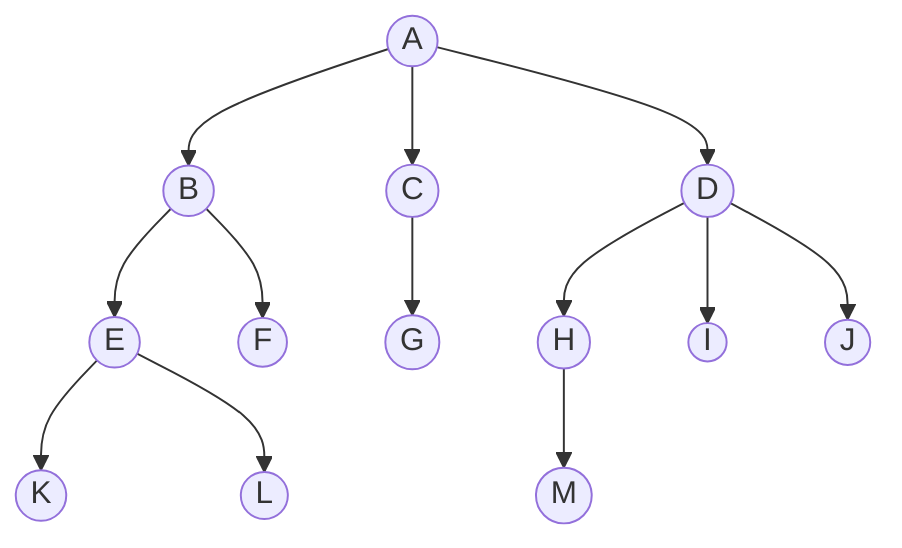

## 树的概念、性质
- 根结点没有前驱。
- 根结点以外所有结点都必须是1个前驱，不能多不能少
- 所有结点都可以有0个或多个后继。
- n个结点的树有n-1条边。

- 从根开始到某个结点上所有其他的结点都是这个结点的祖先。K的祖先是ABE。
- E是K的双亲。双亲这个名词具有误导性，双亲指的不是2个结点，而是一个结点，其实就是父结点。根节点A是唯一没有双亲的结点。
- K是E的孩子。
- K和L是兄弟。它们具有相同的双亲结点。
- 双亲结点是兄弟的所有结点互为堂兄弟。EFGHIJ互为堂兄弟。这个可以借鉴现实亲戚关系，堂兄弟这个概念涉及到3代人。
- 总边数/分支数：所有的线的根数
- 第x层：从上到下从1开始计数。
- 结点的深度：所在层的编号。
- 树的深度/高度：树最多有多少层。
- 结点的度：他有多少孩子
- 树的度：结点的度的最大值（一个人最多有多少孩子）
- 分支结点（非终端结点）：度>0
- 叶结点（终端结点）：度=0
- 有序树无序树：人为决定树的属性。从左到右的顺序能不能互换。现在把B和D的两棵子树换一下，如果我说他说无序树，那么没有发生改变；我说他是有序树，那就发生了改变，不是同一棵树。
- 路径：两个结点之间通过的结点序列。树的方向是单向的，向下的，如果你要逆着往上走才能到是不行的，这时路径不存在。
- 路径长度：路径经过的边的数量
- 结点数n=结点度数之和+1（每个结点负责数他下面的孩子，根结点没人数他，得+1）
- 度为m的树，第i层至多$m^{i-1}$个结点。
- 高度为h的m叉树至多$\frac{m^h-1}{m-1}$个结点。等比数列求和一下就有了。
- 度为m，具有n个结点的树最小高度$\lceil \log_m (n(m-1)+1) \rceil$ 
	- 让每层的结点全部塞满，这就是上一条的结果， 前h-1层塞满是$\frac{m^{h-1}-1}{m-1}$。
	- 前h层塞满是$\frac{m^h-1}{m-1}$，n介于这两者间，那么高度就是h。
	- 写出来是：$\frac{m^{h-1}-1}{m-1} < n \leq \frac{m^h-1}{m-1}$.
	- 右边可以取等，那就是h层刚好满，左边不能取等，那样变成h-1层了。
	- 这样得到$\log_m (n(m-1)+1) \leq h < \log_m (n(m-1)+1)+1$,而h是整数。于是得到答案。
- 度为m，具有n个结点的树最大高度n-m+1
	- 让一层有m个孩子（1层），剩下n-m个结点全部一个点一层（n-m层），所以总共的层数就是这两部分
- 最上面我们知道，n个结点的树有n-1条边。也就是结点数n=总边数+1。现在加2个结论：
	- 结点数n=每种度数的结点数之和
	- 总边数=每种度数的结点数乘度数之和
	- 然后得到：$n_0 + n_1 + n_2 + \cdots + n_m = (1n_1 + 2n_2 + \cdots + mn_m) + 1$
	- 在m=2（二叉树）下，表达为$n_0 = n_2 + 1$，这是下面的二叉树重要结论。

## 二叉树
类似于度为2的有序树。但是有区别，二叉树是可以为空的，不一定要存在有度为2的结点，只是度最高不能超过2.另外，有序数的孩子只有一个结点的话，这个结点是无法区分的。但是二叉树的孩子结点必须属于左结点或是右结点，放左右的两个二叉树是不一样的二叉树。
### 特殊二叉树
#### 满二叉树
全部塞满了。高度为h，有$2^h-1$个结点。
#### 完全二叉树
不一定塞满。但是从上到下，从左到右紧密排列，这些部分全部填满了，中间不允许有空缺。
#### 二叉排序树
左子树结点的值都小于根节点，右子树结点的值都大于根结点。左右字数也是二叉排序树。
#### 平衡二叉树
任何结点左右子树结点数量差值绝对值≤1.
#### 正则二叉树
所有结点都只有0个或2个孩子。也就是不存在度为1的结点。
### 二叉树性质
- $n_0 = n_2 + 1$上面已经出现过了。
- 第k层最多$2^{k-1}$个结点，树的性质中已经出现过了
- 高度为h的二叉树至多$2^h-1$个结点，树的性质中已经出现过了。

*TODO：p131下方继续*